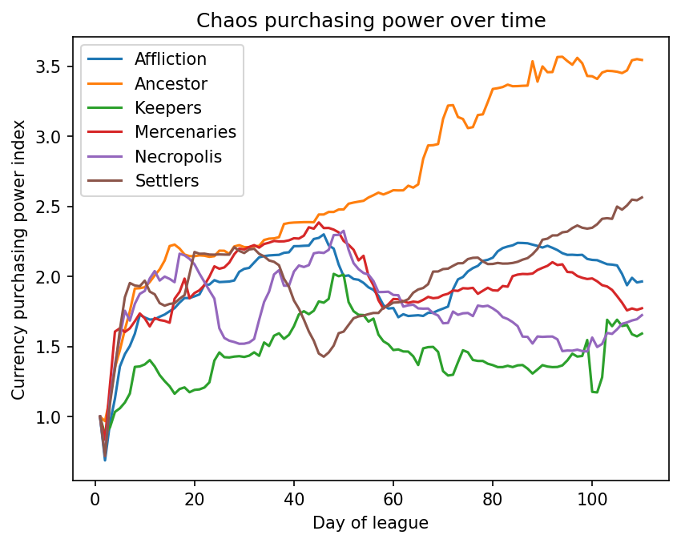
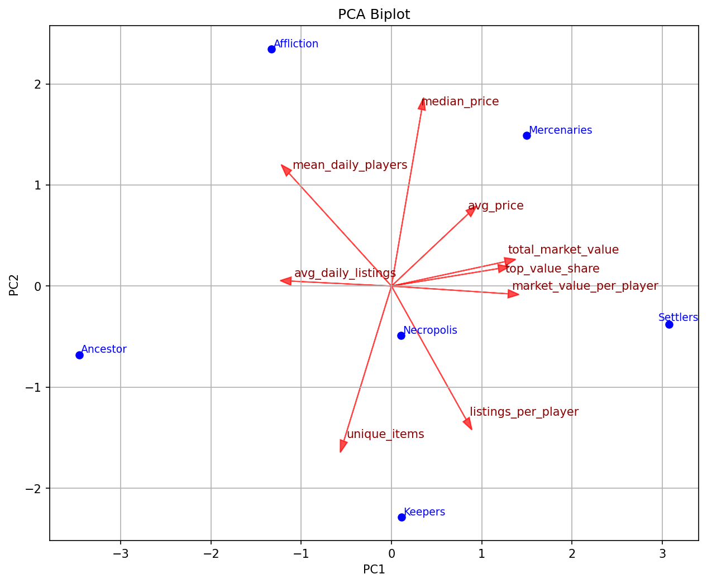
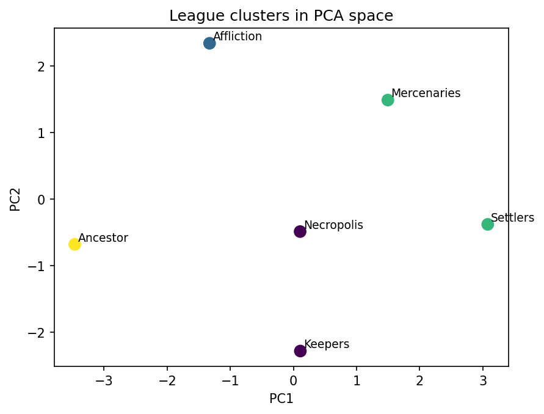
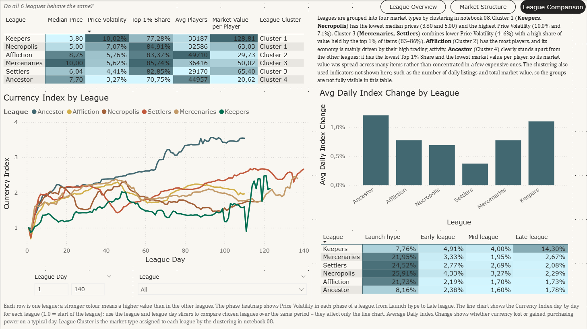

# PoeMarketAnalyser

## Key results
- 10,797 items, 6 leagues, 4,163 daily player records
- Player count vs currency index: Pearson r from −0.54 to −0.93 in 4 of 6 leagues (Ancestor −0.93, Settlers −0.67, Affliction −0.61, Keepers −0.54), confirmed by Spearman. In the other 2 leagues (Mercenaries r = −0.36, Necropolis r = −0.10) there is no consistent relationship (Spearman −0.02 and +0.41), so the effect is not universal.
- PCA (6 leagues): 3 components ≈ 89% variance; K-means and Ward clustering agree on 4 market types 
- Mirage case study: new league forms its own cluster; 2 of 10 predicted gems in top-20 price rises (small sample)

Full conclusions: [Final remarks](final_remarks.md)

## Power BI dashboard

An extension added after the university project: a Power BI report built on aggregates of the project data
(Power Query, star-schema model, 11 DAX measures validated against pandas). Three pages answer three questions:
how the market changes during a league, which categories and items drive it, and whether all six leagues behave
the same; a drill-through page shows the price history of a single item.

Report pages, data model, measures and validation: [`powerbi/README.md`](powerbi/README.md).
Report file: [`PoE_Market.pbix`](powerbi/PoE_Market.pbix), PDF export: [`PoE_Market.pdf`](powerbi/PoE_Market.pdf).

## Limitations 
- Only 6 leagues, so the sample is small
- Correlation does not imply causation
- Non-stationary time series (no detrending yet)
- Balance changes by the developers are an external factor that is not modelled
- The Mirage case study covers only 7 days

## How to run
- Python 3.11
- Install dependencies: `pip install -r requirements.txt`
- Data is not stored in the repository (it is about 6 GB). The raw item and currency prices (about 2.2 GB) are available as assets of the [v1.0-data release](https://github.com/NataliaMiodowska/PoeMarketAnalyser/releases/tag/v1.0-data). Download them and place the files in:
  - `data/items_data_raw/` (`<League>.items.csv`)
  - `data/currency_data_raw/` (`<League>.currency.csv`)
- **The raw player series is intentionally not included.** SteamDB's [FAQ](https://steamdb.info/faq/) prohibits publishing its data in its entirety, so I do not redistribute the downloaded player series (`players_daily.csv`, `players_mirage.csv`) in this repository or in the release. The only player counts in the repository are the daily values for the periods of the six analysed leagues used by the Power BI report (columns `players` and `players_norm` in `powerbi/data/fact_daily_league.csv`, and the same values inside `powerbi/PoE_Market.pbix`). The counts come from the [SteamDB chart for Path of Exile](https://steamdb.info/app/238960/charts/), where the daily series can be downloaded. To reproduce the player analysis (notebooks 01 and 06–09), download it yourself and prepare:
  - `data/players_data_raw/players_daily.csv` with the columns `League`, `DateTime`, `Players` (semicolon-separated, one row per league and day, as read in notebook 01),
  - `data/players_data_raw/players_mirage.csv` with the columns `League`, `Date`, `Players` for the Mirage case study (notebook 09).
- **Mirage item prices are not included either.** They were collected from the public [poe.ninja API](https://poe.ninja/docs/api) during the first days of the league, and poe.ninja does not state terms for redistributing API data. To reproduce the Mirage case study (notebook 09), prepare `data/items_data_raw/Mirage.items.csv` with the same columns as the other item files (`League;Date;Id;Type;Name;BaseType;Variant;Links;Value;Confidence`).
- Run the notebooks in `notebooks/` in order, from 01 to 09. Notebook 01 builds all processed files from the raw ones.
- Item and currency prices come from [poe.ninja](https://poe.ninja/poe1/data), see [Data sources and licence](#data-sources-and-licence).

## Data sources and licence

**Item and currency prices:** [poe.ninja](https://poe.ninja), *Raw Economy Data Dumps*
(<https://poe.ninja/poe1/data>), licensed under
[CC BY-SA 3.0](https://creativecommons.org/licenses/by-sa/3.0/).

- The files in the [v1.0-data release](https://github.com/NataliaMiodowska/PoeMarketAnalyser/releases/tag/v1.0-data)
  for the six analysed leagues (`<League>.items.csv`, `<League>.currency.csv`) are unmodified copies
  of the poe.ninja dumps.
- The files in `powerbi/data/`, the Power BI report (`powerbi/PoE_Market.pbix`, `powerbi/PoE_Market.pdf`)
  and the charts in `images/` are adapted from these dumps. Changes made in notebook 01: leagues merged and
  limited to the six analysed leagues; currency rates with Low confidence removed and only rates paid in
  Chaos Orb kept; for items, the Id, BaseType and Variant columns dropped, 5- and 6-link versions removed,
  invalid item types and records with missing values removed, zero values removed. Changes made in
  `powerbi/export_for_powerbi.py`: duplicate item prices collapsed with the median; prices aggregated to
  weekly medians per item and to daily league indicators (currency index, market value).
- These adapted data files are shared under the same licence,
  [CC BY-SA 3.0](https://creativecommons.org/licenses/by-sa/3.0/).

**Mirage item prices (notebook 09):** collected from the public [poe.ninja API](https://poe.ninja/docs/api)
during the first days of the league. They are not covered by the CC BY-SA licence above and are not
redistributed (see *How to run*).

**Player counts:** [SteamDB](https://steamdb.info/app/238960/charts/) (the figures come from the Steam API). The raw series
is not redistributed; the Power BI files contain only the daily counts for the six analysed league periods (see *How to run*).
These player columns are not covered by the CC BY-SA licence above.

Path of Exile is a trademark of Grinding Gear Games. This project is not affiliated with
Grinding Gear Games or poe.ninja.

## Project context
final project, Data Science Postgraduate Studies at Wrocław University of Economics and Business, defended March 2026

## Scope: university project vs. later extensions

| Part | What it contains | Status |
| --- | --- | --- |
| **University project** (postgraduate final project) | `notebooks/` 01–09, `final_remarks.md`, all analyses, charts and conclusions | Completed and defended in March 2026. The analytical work was finished with the notebook commits of March 2026 (last: [`81a8bba`](https://github.com/NataliaMiodowska/PoeMarketAnalyser/commit/81a8bba)). |
| **README edits after the defence** | Key results, limitations, how to run, project context, charts embedded in the README | Presentation only. No new data, analyses or charts were created; the charts in `images/` come from the notebooks. |
| **Extension after the university project** | `powerbi/`: aggregated data export and the Power BI dashboard built on top of it | Not part of the graded project. Added later to show how the project is being developed further. **Status: completed** (November 2026): data export (`export_for_powerbi.py` and the aggregated CSV files in `powerbi/data/`), data model, DAX measures validated against pandas, three report pages with a drill-through page, PDF export and screenshots; see [`powerbi/README.md`](powerbi/README.md). |

`powerbi/export_for_powerbi.py` and `powerbi/validation/validation.py` were written by Claude Code (Anthropic's AI coding assistant).

---

## Introduction

### Path of Exile (PoE)

Path of Exile is an online action role-playing game (ARPG) developed by Grinding Gear Games and released in 2013. The game belongs to the hack-and-slash type, where players explore different areas, defeat enemies, and collect equipment to improve their characters.
Unlike many other ARPGs, Path of Exile does not use a traditional gold-based economy. Instead, the game relies on a complex barter system in which various items function as currency. 

Players obtain items through gameplay activities such as defeating monsters, completing quests, or engaging in endgame content. These items can be traded between players, creating a dynamic player-driven market. Some items are very common and have almost no value, while others are extremely rare and highly desirable.

The game operates in seasonal cycles called leagues. Since the game's introduction, 41 leagues have been released. Each league introduces new mechanics, balance changes, and additional items, which can significantly affect the in-game economy. At the start of every league the economy resets, which creates a natural environment for studying how virtual markets evolve over time.

---

## Project Motivation

The player-driven economy of Path of Exile forms a complex market where thousands of items are traded and their values fluctuate over time. Because leagues periodically reset the game economy, each league represents a new economic system that evolves independently.

Analysing the dynamics of item prices during leagues provides an opportunity to study how virtual economies behave under changing conditions such as new content releases, balance changes, and player behavior.

The dataset used in this project contains daily aggregated price estimates for items across six latest leagues. Each record represents the estimated market value of a specific item on a given day.

---

## Project Objectives

The main goal of this project is to analyse the economic dynamics of Path of Exile leagues using item price data.
The analysis focuses on identifying patterns in item price evolution and measuring economic indicators that describe the state of the in-game market.

The specific objectives are:

1. Analyse the distribution and temporal dynamics of item prices.
2. Measure market stability by analysing price volatility.
3. Construct a **currency purchasing power index** based on a basket of representative currency items.
4. Analyse inflation and deflation trends in the in-game economy across different stages of a league.
5. Examine how player activity evolves throughout the lifecycle of a league.
6. Investigate the relationship between player activity and economic indicators such as prices, currency purchasing power, and market stability.
7. Compare different leagues using aggregated economic indicators.
8. Identify similarities between leagues using clustering techniques.
9. Evaluate whether historically observed early-league price spikes can be used to predict profitable early investments in newly released leagues.

---

## Dataset Description

The dataset used in this project consists of three main components:

1. Items dataset
2. Currency dataset
3. Players dataset

These datasets provide information about item values, exchange rates between currencies in the game economy, and the number of players active in the game each day.

## Items Dataset

The item dataset contains daily estimated prices for items in each league.
Each record represents the estimated market value of an item for a given day.

| Column     | Description                                 |
| ---------- | ------------------------------------------- |
| League     | Name of the league                          |
| Date       | Date of the price estimate                  |
| Type       | Item category (e.g. UniqueWeapon, BaseType) |
| Name       | Name of the item                            |
| BaseType   | Base type of the item                       |
| Variant    | Variant of the item if applicable           |
| Links      | Number of links in the item if applicable   |
| Value      | Estimated market value of the item          |
| Confidence | Reliability of the price estimate           |

The **Confidence** column indicates the reliability of the estimated price.

| Confidence | Meaning                                                            |
| ---------- | ------------------------------------------------------------------ |
| High       | The value is based on many observations and is considered reliable |
| Medium     | The estimate is based on a moderate number of observations         |
| Low        | The value is based on very few observations and may be inaccurate  |

Low confidence values may occur when items are very rare and only a few listings are available in the market.

---

## Currency Dataset

The currency dataset describes exchange rates between different in-game currencies.

Unlike traditional economies, Path of Exile uses multiple items as currencies. These items can be exchanged with each other, forming a complex currency market. Each record represents the exchange rate between two currencies at a specific time.

| Column     | Description                                |
| ---------- | ------------------------------------------ |
| Date       | Date of the exchange rate                  |
| Get        | Currency received in the trade             |
| Pay        | Currency paid in the trade                 |
| Value      | Exchange rate between the currencies       |
| Confidence | Reliability of the estimated exchange rate |

---

## Players Dataset

The players dataset describes the daily number of active players during different Path of Exile leagues. These data provide insight into player activity over time and allow the analysis of how the player population evolves throughout the duration of a league. Each record represents the number of players recorded for a specific league on a given day.

The player activity data are obtained from Steam statistics published by [SteamDB](https://steamdb.info/app/238960/charts/). Although Path of Exile can also be played through a standalone client, Steam accounts for the majority of the player base and therefore provides a sufficiently representative sample. Since the analysis focuses on comparisons between leagues using the same data source, the dataset remains consistent and comparable across the entire study period.

| Column  | Description                                    |
| ------- | ---------------------------------------------- |
| League  | Name of the Path of Exile league               |
| Players | Estimated number of active players on that day |
| Date    | Date of the recorded player count              |

---

## Data Characteristics

The dataset exhibits several important characteristics:

1. Item prices are strongly right-skewed because most items are inexpensive while a small number of rare items are extremely valuable.
2. Prices are recorded daily, which allows analysis of how item values evolve during a league.
3. Each league represents a separate economic environment with its own supply and demand dynamics.

---
## Research Questions

The project aimed to answer the following questions:

* How item prices evolve during a league,
* how stable the market is,
* how the purchasing power of currency changes over time,
* whether leagues exhibit similar economic structures,
* how currency inflation and deflation emerge during different stages of a league,
* how player activity changes throughout the league lifecycle,
* whether changes in player activity correlate with economic indicators such as prices, currency purchasing power, or market stability.

## Case study: Early economy of the Mirage league

In addition to the historical league analysis, an additional case study was conducted for the newly released **Mirage** league. Since only the first days of market data were available, the analysis focuses on the early-stage economy of the league.

Using the analytical framework developed in the project, the early economic indicators of Mirage were compared with the early phases of previous leagues. Additionally, predictions derived from the historical analysis of early-league price spikes were evaluated by examining whether the previously identified high-growth items also experienced significant price increases during the first days of the Mirage league.

---
## What I would do next
- **Detrending**: remove the trend from the price and player series (e.g. first differences or a rolling baseline) and re-test the player–index relationship, to check whether the correlations survive stationarity.
- **Supervised model for early-league price spikes**: predict which items will spike in the first days of a league, with a time-based split and a baseline to beat.
- **More leagues** and a structured evaluation of the Mirage predictions once more data is available.