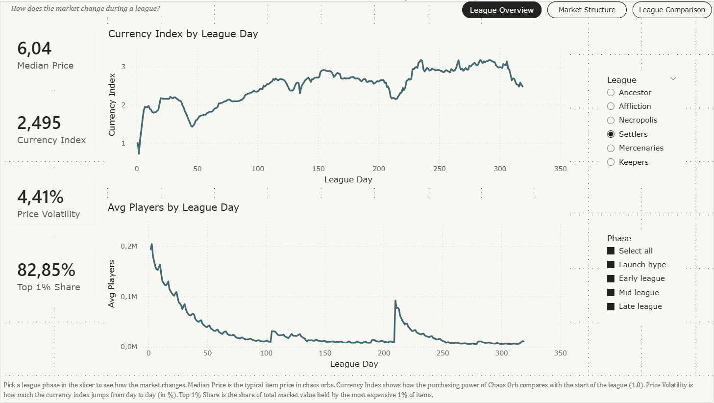
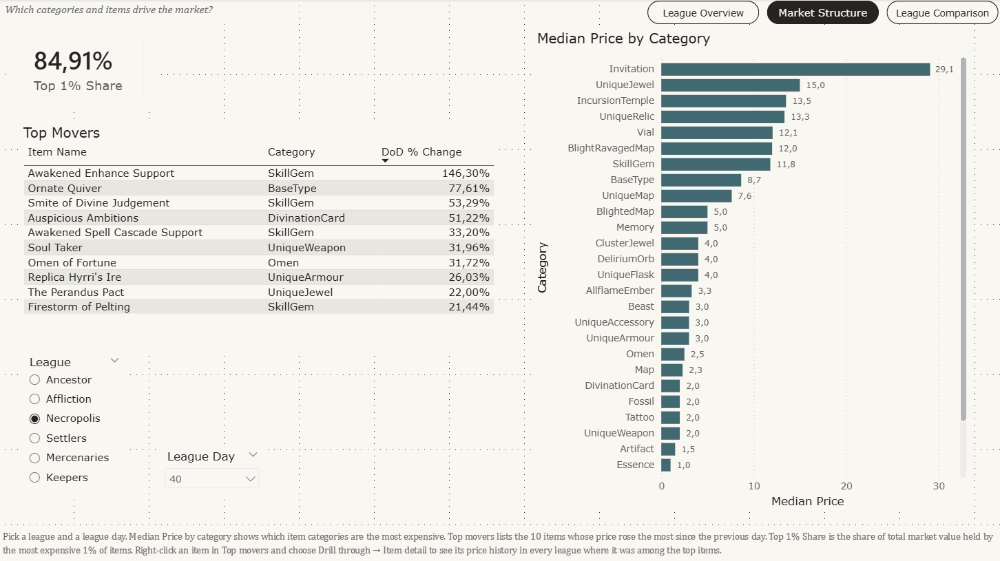
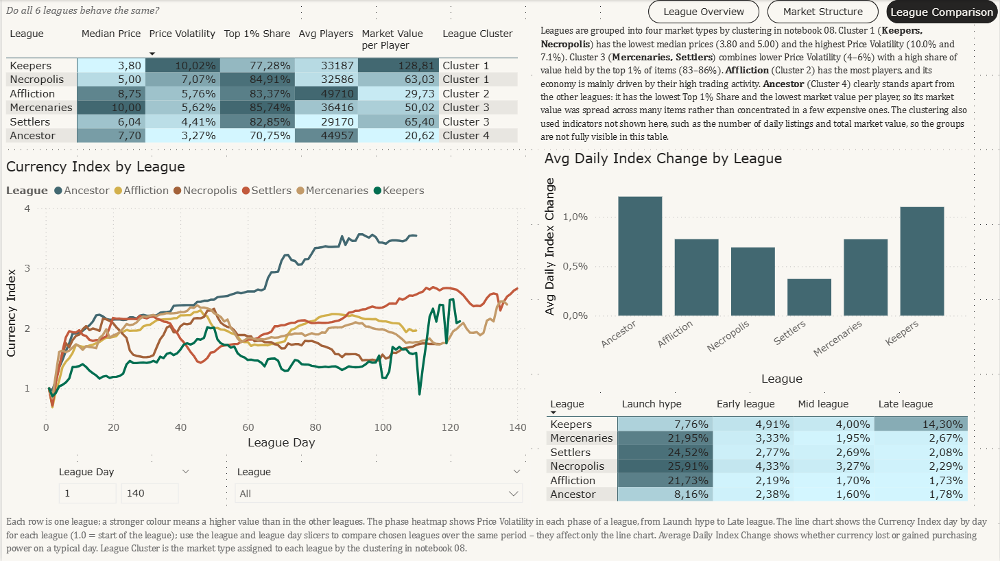
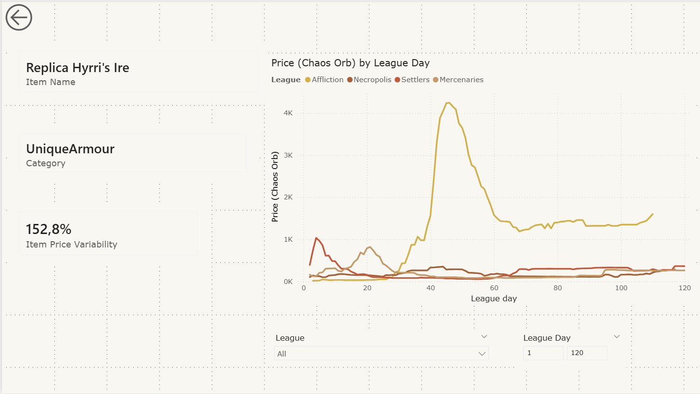

# Power BI dashboard

A Power BI report that compares the economy of six Path of Exile leagues: how the market changes during a league,
which items drive it, and whether all leagues behave the same. It is built on aggregates of the data analysed in the notebooks.

**Status: completed.**

## How to open

- [`PoE_Market.pbix`](PoE_Market.pbix): open in Power BI Desktop (built in version 2.149.1429.0 64-bit, November 2025).
  The data is stored inside the file, so no refresh is needed.
- [`PoE_Market.pdf`](PoE_Market.pdf): static export of the report pages, for viewing without Power BI.

## Report pages

The report has three pages with navigation buttons and a hidden drill-through page.
Pages 1–3 start with the question they answer and end with a short *how to read* note.

### 1. League overview: *How does the market change during a league?*

One league at a time (league slicer), optionally narrowed to a league phase (Launch hype: days 1–7,
Early league: 8–30, Mid league: 31–70, Late league: 71+). Cards show Median Price, Currency Index, Price Volatility
and Top 1% Share; line charts show the Currency Index and the average number of players by league day.



### 2. Market structure: *Which categories and items drive the market?*

For a chosen league and league day: median price by item category, the Top 1% Share, and *Top movers*,
the 10 items whose price rose the most since the previous day. Right-click an item in *Top movers* and choose
*Drill through → Item detail* to see its price history.



### 3. League comparison: *Do all 6 leagues behave the same?*

A table of the main indicators for each league with a colour scale and the market type (cluster) assigned in
notebook 08, a text that describes the four clusters, a heatmap of Price Volatility by league phase,
the average daily change of the currency index, and the Currency Index by league day for all leagues on one chart
(league and league day slicers affect only this chart).



### 4. Item detail (drill-through, hidden page)

Opened from *Top movers* on page 2. Shows the item name, category and Item Price Variability, and the daily price
of the item in every league where it was among the top items (see *Limitations*). League and league day slicers
narrow the chart; the arrow in the top left corner goes back to page 2.



## Data

The report loads the aggregated CSV files from `powerbi/data/`, prepared by `export_for_powerbi.py`
(written by Claude Code) from the processed project data.

| Table | Rows | Grain |
|---|---|---|
| `fact_daily_league` | 916 | league × day: currency index, daily index change, players, market value |
| `fact_item_weekly` | 575,241 | league × week × item: median price |
| `fact_item_daily_top` | 254,936 | league × day × item, top items only: daily price |
| `dim_item` | 8,803 | item, 37 categories |
| `dim_league` | 6 | league dates and cluster |
| `dim_date` | 928 | calendar table (DAX `CALENDAR`), 2023-08-18 to 2026-03-02, marked as date table; calculated columns `phase` and `league_day` taken from `fact_daily_league` |

Star schema: facts are related to the dimensions many-to-one with single-direction filtering.
Leagues do not overlap in time, so each date belongs to one league at most. This is why the league phase is stored in `dim_date`: a phase slicer then filters all fact tables, and every phase exists in every league.

Power Query loads the five CSV files and sets the column types; `dim_date` is created in DAX.
Item prices come from the High confidence price estimates only.

## DAX measures

All measures are stored in the `_Measures` table, grouped in display folders.

| Folder | Measure | What it shows |
|---|---|---|
| Prices | Median Price | typical item price in chaos orbs (median of weekly item prices) |
| Prices | DoD % Change | day-over-day price change of an item; meaningful when one day is selected |
| Prices | Price Change Rank | rank of items by DoD % Change, used to show the top 10 *Top movers* |
| Prices | Item Price Variability | coefficient of variation of an item's daily price (standard deviation / mean) |
| Market | Currency Index | purchasing power of Chaos Orb compared with the start of the league (1.0) |
| Market | Price Volatility | standard deviation of the daily change of the currency index, as in notebook 06 |
| Market | Avg Daily Index Change | average daily change of the currency index: whether currency lost or gained value on a typical day |
| Market | Top 1% Share | share of total market value held by the most expensive 1% of items |
| Market | League Cluster | market type of the league from the K-means clustering in notebook 08 |
| Players | Avg Players | average daily number of players (days without data are skipped) |
| Players | Market Value per Player | average daily market value divided by the average number of players |

Two helper measures (Total Price, Price Prev Day) are hidden.

## Validation

DAX results were exported from Power BI (*Export data*) to `powerbi/validation/` and compared with the same
measures computed in pandas from `powerbi/data/` by [`validation/validation.py`](validation/validation.py)
(written by Claude Code). Run it from the repository folder:

```bash
python powerbi/validation/validation.py
```

**Measures vs pandas** (tolerance: relative difference below 0.1 %; Power BI exports rounded values):

| League | Measure | Power BI | pandas | Difference |
|---|---|---|---|---|
| Keepers | Median Price | 3.80 | 3.80 | 0.000 % |
| Keepers | Currency Index | 1.505 | 1.5055 | 0.031 % |
| Keepers | Avg Players | 33,187 | 33,186.6 | 0.001 % |
| Keepers | Top 1% Share | 77.28 % | 77.28 % | 0.001 % |
| Necropolis | Median Price | 5.00 | 5.00 | 0.000 % |
| Necropolis | Currency Index | 1.772 | 1.7724 | 0.025 % |
| Necropolis | Avg Players | 32,586 | 32,586.0 | 0.000 % |
| Necropolis | Top 1% Share | 84.91 % | 84.91 % | 0.004 % |

**Price Volatility** (standard deviation of the daily currency index change, `STDEV.S`) matches
`league_phase_summary.csv` from notebook 06 for all 24 league × phase combinations (absolute difference below 1e-6).

**Expected differences** (not errors, described here instead of being corrected):
- Player counts are joined to the daily data by date, while notebook 06 joins them by league day,
  so average player numbers can differ slightly from `population_economy.csv`.
- Duplicate item prices were collapsed with the median during the export, so median price,
  top 1% share and market value can differ slightly from notebook 07.
- Weekly prices are assigned to a phase by the week's start date, so phase boundaries for Median Price
  and Top 1% Share can be shifted by a few days.

## Limitations

- `fact_item_daily_top` keeps only the 300 items per league with the highest sum of daily prices, to keep the file
  small. *Top movers* and *Item detail* therefore show only these items, and *Item detail* shows an item only in
  the leagues where it was among them.
- An item has no daily price on days without a High confidence estimate. The line charts connect the points on
  both sides of such a gap, so a straight segment means missing days, not a steady price.
- The report uses Polish regional settings, so numbers on the pages and in the screenshots have a decimal comma;
  the CSV files and this README use a decimal point.

## Data source

Item and currency prices: [poe.ninja](https://poe.ninja/poe1/data), CC BY-SA 3.0.
The price data in `powerbi/data/` and in the report is adapted from the poe.ninja data and shared under the same licence.
Player counts (columns `players` and `players_norm` in `fact_daily_league`): [SteamDB](https://steamdb.info/app/238960/charts/),
daily values for the six analysed league periods only; they are not covered by the CC BY-SA licence.
Details: [Data sources and licence](../README.md#data-sources-and-licence).
